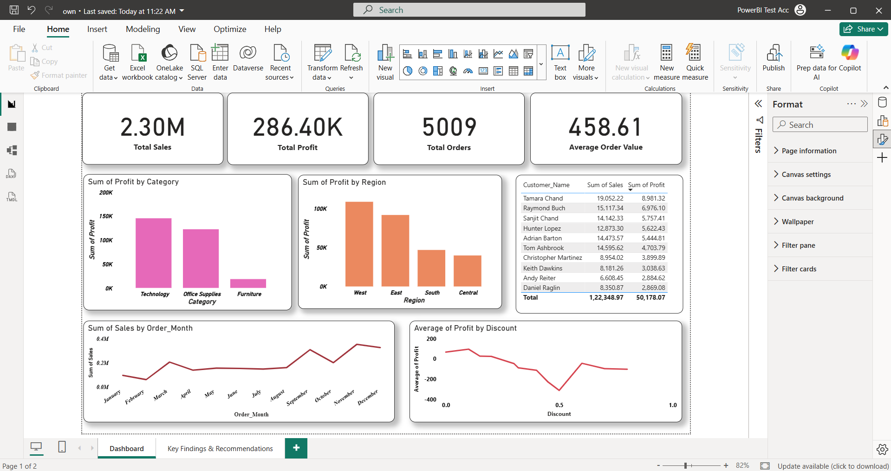
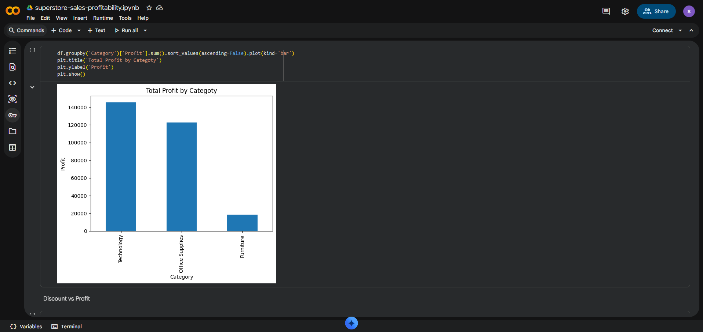
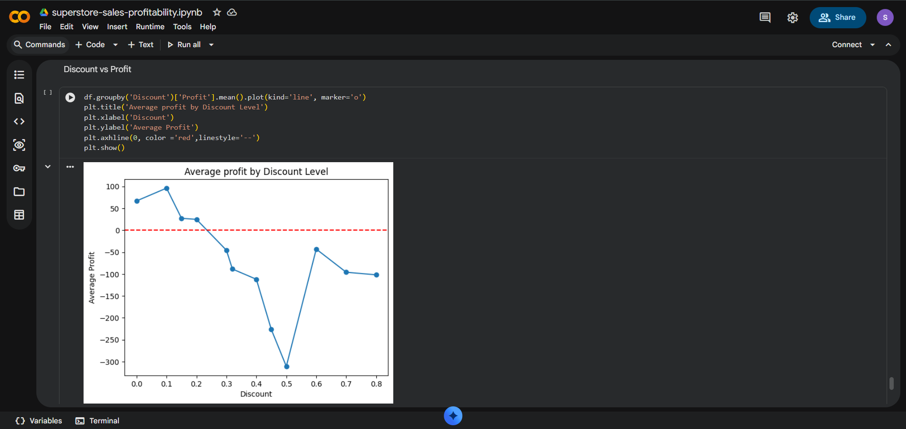
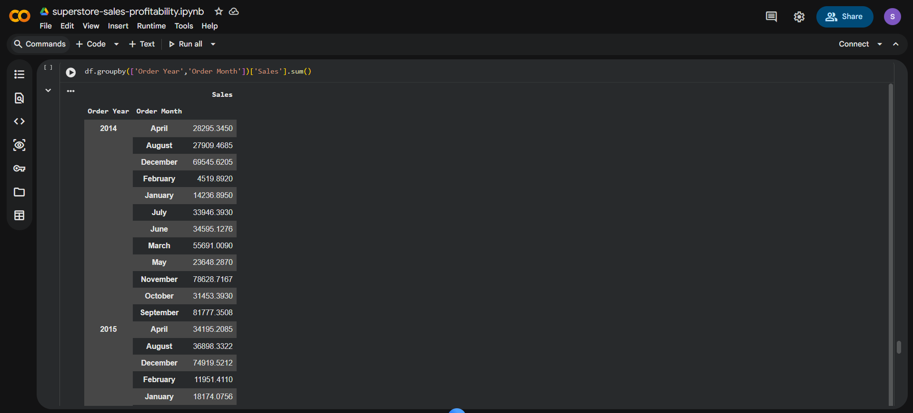
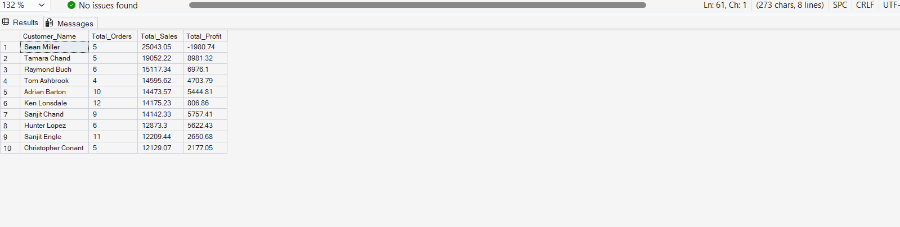

# E-commerce Sales & Profitability Analysis

An end-to-end analysis of 9,994 US retail order lines (2014 to 2017) from the Superstore dataset, using Python, SQL Server and Power BI. The project shows that high sales do not always mean high profit: Furniture sells almost as much as Technology but earns a fraction of the profit, discounts of 30% or more lose money on average, and the top customer by sales actually lost money for the business. The findings are summarised in a Power BI dashboard.

## Tools Used

| Tool | Purpose |
|---|---|
| Python (pandas, matplotlib) in Google Colab | Data checks, feature engineering, exploratory analysis and charts |
| SQL Server (database `SuperstoreDB`, table `Superstore_Cleaned`) | Business queries: KPIs, category, region, monthly trend and customers |
| Power BI | Dashboard with KPIs and visuals |

## Dashboard



The dashboard has 4 KPI cards (sales, profit, orders, average order value), profit by category, profit by region, average profit by discount, a monthly sales trend and a top-10 customers table (sorted by profit). A second page, "Key Findings & Recommendations", summarises the insights.

## Business Problem

A retail business wants to know where its money is really made and lost. Sales alone can be misleading, so this project looks at **profitability** across categories, regions, discount levels, seasons and customers to answer:

- Which categories and regions drive profit, and which do not?
- How much discount is too much?
- When does the business sell the most?
- Are the biggest customers also the most profitable?

## Key Findings

**Overall performance**

- Total sales: **2,297,200.86**
- Total profit: **286,397.02** (about **12.5%** margin)
- Total orders: **5,009**
- Average order value: **458.61** (total sales divided by number of orders)

**Category**

| Category | Sales | Profit | Margin |
|---|---|---|---|
| Technology | 836,154.03 | 145,455 | 17.4% |
| Office Supplies | 719,047.03 | 122,491 | 17.0% |
| Furniture | 741,999.80 | 18,451 | 2.5% |

- Furniture sells almost as much as Technology but earns only about one-eighth of its profit.
- Within Furniture, the **Tables** sub-category lost about **17,725** in total.

**Region (profit)**

| Region | Profit | Margin |
|---|---|---|
| West | 108,418 | 14.9% |
| East | 91,523 | 13.5% |
| South | 46,749 | 11.9% |
| Central | 39,706 | 7.9% |

Central has higher sales than South but the lowest profit and margin.

**Discounts**

- Average profit stays positive up to about a **20%** discount.
- Average profit turns negative from about a **30%** discount.
- Order lines with a discount of 30% or more (about 14% of all rows) lost about **135,000** in total.

**Seasonality**

- Sales peak in **November and December** (September is also strong).
- Sales are lowest in **February**.

**Customers**

- The top customer by sales, **Sean Miller** (25,043 in sales), actually lost money (**-1,980.74** profit).
- The most profitable customer is **Tamara Chand** (**8,981.32** profit on 19,052 in sales).

## Results

### Profit by Category (Python)


### Average Profit by Discount Level (Python)


### Monthly Sales by Year (Python output)


### Top 10 Customers by Sales (SQL result)


## Recommendations

1. **Cap discounts at around 20%.** Average profit turns negative from about 30%, and deep discounts lost about 135,000 in total.
2. **Review Furniture pricing, discounting and costs**, starting with Tables, which lose money overall.
3. **Protect and grow the West and East regions**, and investigate why Central earns the lowest margin despite higher sales than South.
4. **Prepare for the November and December peak** with stock and marketing, and plan promotions for the slow February period.
5. **Track customers by profit, not just sales.** The biggest customers by sales should be checked for loss-making orders.

## Project Structure

```
ecommerce-sales-profitability-analysis/
├── data/
│   └── Superstore_Cleaned.csv
├── notebooks/
│   └── Superstore_Sales_Analysis.ipynb
├── sql/
│   └── superstore_analysis.sql
├── powerbi/
│   └── Superstore_Dashboard.pbix
├── images/
│   ├── ecommerce_dashboard.png
│   ├── profit_by_category_region.png
│   ├── discount_vs_profit.png
│   ├── monthly_sales_trend.png
│   └── top_customers.png
└── README.md
```

## How to Reproduce

1. **Get the raw data:** download the dataset from [Kaggle](https://www.kaggle.com/datasets/vivek468/superstore-dataset-final) (the file is `Sample - Superstore.csv`).
2. **Python analysis:** open `notebooks/Superstore_Sales_Analysis.ipynb` in Google Colab, upload `Sample - Superstore.csv` to the Colab files area (`/content/`), and run all cells. The notebook adds `Order Month`, `Order Year`, `Profit Margin` and `Shipping Days`, then saves `Superstore_Cleaned.csv`. (This repository already includes the finished file in `data/`.)
3. **SQL analysis:** in SQL Server, create the database `SuperstoreDB`, import `data/Superstore_Cleaned.csv` as a table named `Superstore_Cleaned` (for example with the Import Flat File wizard in SSMS), then run `sql/superstore_analysis.sql`. Column names with spaces become underscores (for example `Order_ID`), which is what the queries use.
4. **Dashboard:** open `powerbi/Superstore_Dashboard.pbix` in Power BI Desktop. If Power BI asks, point it to your SQL Server table or to `data/Superstore_Cleaned.csv`.

## Data Source

Kaggle: [Superstore Dataset](https://www.kaggle.com/datasets/vivek468/superstore-dataset-final) (9,994 rows, US retail, 2014 to 2017).

## Limitations

- The dataset is a public sample of US retail orders from 2014 to 2017, so the results may not reflect current business conditions.
- The raw data had no missing values or duplicates, so preparation was mainly date conversion and feature engineering.
- The analysis is descriptive. It shows relationships (for example, high discount and low profit) but does not prove cause and effect.
- The discount thresholds (about 20% and 30%) are approximate and based on average profit per order line.
- No forecasting or predictive modelling is included.
- Cost details such as shipping and operating expenses are not available beyond the profit column in the data.

## Author

**Rupesh Maddula**

- GitHub: [rupeshMadddula](https://github.com/rupeshMadddula)
- LinkedIn: [rupesh-maddula](https://www.linkedin.com/in/rupesh-maddula/)
